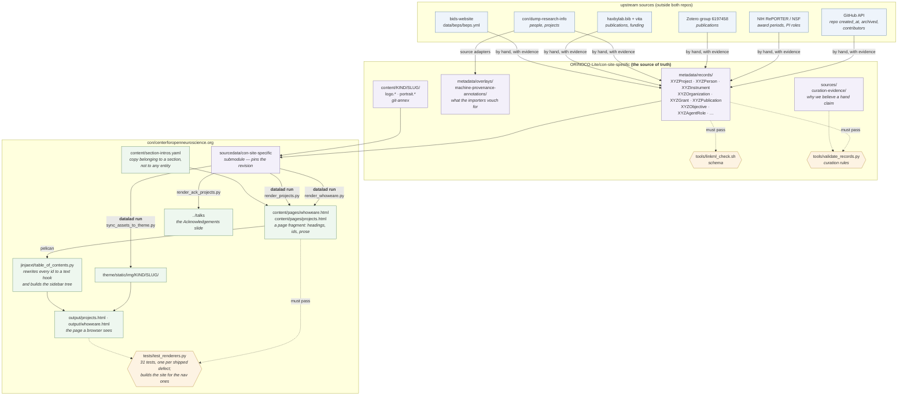

# How metadata gets from the records to the website

Every arrow below is a command, and every command that writes into this
repository is run under `datalad run`, so the commit that produced a file
carries the command, its inputs and its outputs. `git log` on any generated
file answers "where did this come from".



## Which command alters what

| command | reads | writes | run under |
| --- | --- | --- | --- |
| **`sync_assets_to_theme.py --write`** | submodule `content/` | `theme/static/img/{projects,instruments,organizations}/`, `theme/static/img/team/` | **`datalad run`** |
| **`render_whoweare.py --out …`** | submodule `metadata/records/`, submodule `content/`, `content/section-intros.yaml` | `content/pages/whoweare.html` | **`datalad run`** |
| **`render_projects.py --out …`** | the same three | `content/pages/projects.html` | **`datalad run`** |
| `render_ack_projects.py` | submodule `metadata/records/`, `content/selections/` | the deck's generated block (stdout, or `--out`) | by hand |
| `pelican content -o output` | `content/`, `theme/`, `jinjaext/` | `output/` | build step |
| `pytest tests/` | scripts, records, a throwaway build | nothing | gate |

`make project` is the first three, in that order; `make run-project` is that
under `datalad run`.

Everything here runs **out of** the store; nothing runs into it any more.
Facts get in by editing a record.

## The migration that is over

Until 2026-10-13 there was a second group, running the other way: the
hand-written pages were extracted into `content/people/` and
`content/projects/`, those were enriched into records, and
`render_people.py` rendered them back and diffed, so that no generator took
over a live page until the records could reproduce it exactly. That loop
served its purpose and is gone -- `extract_people.py`, `extract_projects.py`,
`enrich_people.py`, `enrich_projects.py`, `records_from_page.py`,
`render_people.py`, `page_skeleton.py`, `sync_logos.py`,
`harvest_join_dates.py` and `harvest_associations.py` with it.

Two of those could not have been re-run anyway: `harvest_join_dates.py` and
`harvest_associations.py` derive dates from the git history of
`content/pages/whoweare.html` and `projects.html`, and those pages are now
generated -- their history since the handover records renders, not people
arriving. The dates they produced are in the records with their evidence.

The deletion was verified rather than assumed: the two pages were deleted,
rebuilt from the records alone, and came back **byte-for-byte identical**;
the whole built site matched too, except the Atom feed's `<updated>`
timestamp.

## Three representations, not two

A record is YAML; `content/pages/*.html` is a **fragment** -- headings with
explicit `id=`s and no `<nav>`; `output/*.html` is the page a browser gets.
The third step is not cosmetic: `jinjaext/table_of_contents.py` **discards
every explicit `id=`** and replaces it with a hook derived from the heading
text (`DANDI` -> `dandi_`), then builds the sidebar tree from the heading
levels. So

* an anchor written by hand in a record's description has to be spelled the
  way the extension will spell it, not the way the fragment spells it; and
* if the fragment is not well-formed XML the extension returns it
  **unchanged** -- every anchor on the page silently disappears while
  Pelican still exits 0. Hence `conrecords.write_page()` refusing to write.

And a fourth representation that exists only in the browser: which section
the sidebar shows as current, and therefore which section's entries are
visible at all. That is `scrollspy` plus CSS, not markup, so
`test_every_section_expands_when_clicked` drives a real Chromium and clicks
every section on both pages. Three separate things had to be right for it to
pass, and none of them is checkable in the HTML.

A Pelican template error does **not** fail the build: it logs a traceback and
writes nothing, leaving the previous `output/` in place. A measurement taken
against `output/` right after a template edit may be measuring the old page.

### The dev server holds a stale copy of that extension

`develop_server.sh` imports `jinjaext` **once, at startup**. Editing the
extension has no effect on a running server -- but a content edit still
triggers a re-render, which overwrites `output/` using the *old* module. A
fix to the sidebar therefore appears to revert itself. Restart the server:

```bash
./develop_server.sh stop && ./develop_server.sh start 8001
```

## The direction that bit us

The flow is **one-way**: `store → theme → pages`. An edit made downstream
survives only until the next sync. Portraits were cropped in
`theme/static/img/team/` and the next `sync_assets_to_theme.py` silently
restored the 954 KB originals from the store. The fix belonged in
`content/persons/<slug>/portrait.*`, where the asset lives.

Anything hand-edited in `theme/static/img/<kind>/` or in
`content/pages/{whoweare,projects}.html` is temporary. The pages even say so
in a comment: *"Edit the records, not this file."*

## Re-running any of it

```bash
# what produced this file, and from what
git log --format=%B -1 -- content/pages/whoweare.html

# do it again, byte for byte
datalad rerun --explicit <that commit>
```

`--explicit` is needed because the working tree usually carries unrelated
untracked files; the declared inputs and outputs are then the whole of what
the command touches.
