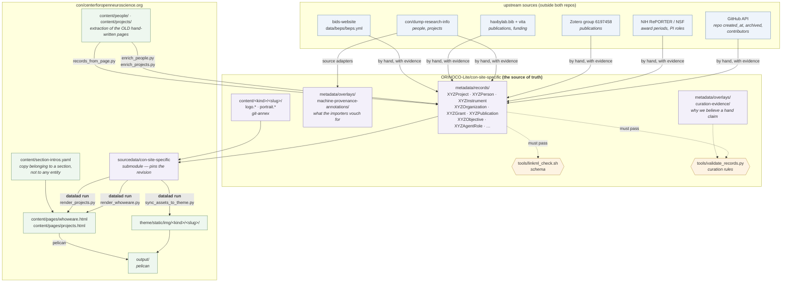

# How metadata gets from the records to the website

Every arrow below is a command, and every command that writes into this
repository is run under `datalad run`, so the commit that produced a file
carries the command, its inputs and its outputs. `git log` on any generated
file answers "where did this come from".



## Which command alters what

| command | reads | writes | run under |
| --- | --- | --- | --- |
| `enrich_people.py --write` | `content/people/` | records `XYZPerson`, `content/persons/*/portrait.*` | by hand |
| `enrich_projects.py --write` | `content/projects/` | records `XYZProject` and friends | by hand |
| `records_from_page.py --write` | `content/projects/` | new `XYZProject` records | by hand |
| `sync_logos.py --write` | `theme/static/img/3rd/` | `content/<kind>/<slug>/logo.*` | by hand |
| `harvest_join_dates.py` | this repo's git history | a JSON report (records edited by hand from it) | by hand |
| **`sync_assets_to_theme.py --write`** | submodule `content/` | `theme/static/img/<kind>/<slug>/`, `theme/static/img/team/` | **`datalad run`** |
| **`render_whoweare.py --out …`** | submodule `metadata/records/`, submodule `content/`, `content/section-intros.yaml` | `content/pages/whoweare.html` | **`datalad run`** |
| **`render_projects.py --out …`** | the same three | `content/pages/projects.html` | **`datalad run`** |
| `pelican content -o output` | `content/`, `theme/` | `output/` | build step |

The first group runs **into** the store and is how hand-curated facts get in.
The second group runs **out of** it and is where `datalad run` applies: those
three commands are the only ones that write generated files into this repo,
so those are the files whose provenance has to be recoverable.

## The direction that bit us

The flow is **one-way**: `store → theme → pages`. An edit made downstream
survives only until the next sync. Portraits were cropped in
`theme/static/img/team/` and the next `sync_assets_to_theme.py` silently
restored the 954 KB originals from the store. The fix belonged in
`content/persons/<slug>/portrait.*`, where the asset lives.

Anything hand-edited in `theme/static/img/<kind>/` or in
`content/pages/{whoweare,projects}.html` is temporary. The pages even say so
in a comment: *"Edit the records, not this file."*

## Re-running any of it

```bash
# what produced this file, and from what
git log --format=%B -1 -- content/pages/whoweare.html

# do it again, byte for byte
datalad rerun --explicit <that commit>
```

`--explicit` is needed because the working tree usually carries unrelated
untracked files; the declared inputs and outputs are then the whole of what
the command touches.
